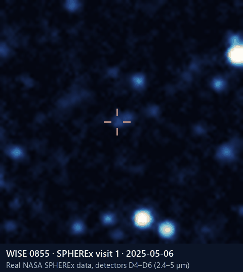

# SkyBlink — find what moves in the infrared sky

**NASA Space Apps Challenge 2026 · Challenge: “Planet X and SPHEREx” · Team DeepSpace**
Nikita Tkachenko (team lead), Dmytro Simonov, Yehor Kaminskyi

### ▶ [Open the live app: skyblink-deepspace.streamlit.app](https://skyblink-deepspace.streamlit.app)

🎬 **Demo video (30 s, English subtitles)** · [download MP4](https://github.com/Nikita455000/skyblink/raw/main/media/skyblink_demo_30s.mp4)
(the space scenes in the video are illustrations; everything below and in the app is real SPHEREx data)


https://github.com/user-attachments/assets/b0862adf-860f-43d6-ac9c-429076c2b3f3




*The coldest known brown dwarf, WISE 0855, in real SPHEREx images from May 2025 to May 2026.
The last frame subtracts the first visit from the last: static stars disappear, the brown dwarf stays.*

SkyBlink is a public web tool that turns NASA’s **SPHEREx** all-sky infrared survey into a time-lapse.
Enter an object name or sky coordinates, and SkyBlink downloads every SPHEREx image of that spot,
aligns them and plays the survey visits like a short video. Anything that moves or changes brightness —
asteroids, comets, brown dwarfs, variable stars — jumps out.

## Features

- **Search** by name (resolved with CDS Sesame, including proper motion) or by RA/Dec; one-click buttons for the
  challenge targets: Barnard’s Star, Epsilon Indi B, WISE 0855, RW Aurigae, R Draconis.
- **Blink** — one frame per SPHEREx visit (median of that visit’s images), with play/pause and speed.
- **Difference** — later visits minus the first: static stars cancel, movers show as a white–black pair.
- **Stack** — all visits combined.
- **Gaia DR3 overlay** — known stars moved to the date of each visit, so a mover with no Gaia circle stands out.
- **Target tracking** — high proper-motion objects are propagated from their catalog epoch to each visit.
- **Spectrum** — click any source to measure it on every SPHEREx image: 0.75–5 µm, six detectors × 17 bands.
- **Choose detectors** (D1–D6) for the time-lapse, **field of view** 2–10′, **GIF export**, and a **shareable URL**
  that reproduces the exact view (`?target=WISE+0855&fov=4&det=456`).

## How it works

1. **Query** — IRSA TAP (`spherex.plane` ⨝ `spherex.artifact`) finds every SPHEREx spectral image covering the position.
2. **Fetch** — cutouts are requested with IRSA’s `?center=…&size=…` service and *streamed*: the download stops after
   the IMAGE, FLAGS, VARIANCE and ZODI extensions, skipping the ~4 MB PSF table in every file. “Server busy”
   answers are retried. Everything is cached on disk.
3. **Clean** — zodiacal light (ZODI) is subtracted and pixels with fatal FLAGS bits are masked.
4. **Align** — each cutout is reprojected (astropy WCS with SIP distortion + `reproject`) onto one north-up grid
   at 3″/pixel; images are grouped into survey visits and median-combined.
5. **Spectrum** — 3×3-pixel aperture photometry at the predicted position on every image; the wavelength of each
   pixel comes from the WAVE-TAB lookup table (WCS-WAVE extension), evaluated directly for speed.

## Data

| Data | Provider | Use |
|---|---|---|
| SPHEREx spectral images (DR1, 102 bands, 0.75–5 µm) | NASA / IPAC IRSA | time-lapse, difference images, spectra |
| Gaia DR3 (`gaia_dr3_source`) | ESA, served by IRSA | known stars and their proper motions |
| Object names and proper motions | CDS Sesame / SIMBAD | search by name |

SPHEREx pixels are 6.15″ wide: nearby sources can blend, and slow movers need several visits to show.

## Speed and archive outages

IRSA’s search services (TAP and SIA) can go down while its image server keeps working — this happened on
15 November 2026, during the hackathon. SkyBlink keeps the challenge targets working anyway:

| Target | Saved with the app | What you get when IRSA search is down |
|---|---|---|
| Epsilon Indi B, RW Aurigae, R Draconis | image list + all cutouts of the default view (4′, D4–D6) and of the spectrum | the full app, opening in ~5–20 s |
| WISE 0855, Barnard’s Star | a saved SkyBlink time-lapse made from real SPHEREx images on 14 Nov 2026 | blink and difference views, clearly labelled as saved |

Everything switches back to live data automatically when IRSA answers. Any other position needs IRSA search.
`scripts/save_target_lists.py` and `scripts/build_seed.py` refresh the saved lists and cutout packs.

## Run locally

```bash
pip install -r requirements.txt
streamlit run app.py
```

Optional: set `SKYBLINK_CACHE` to choose the cache folder (default: the system temp folder).

## Project layout

```
app.py                 Streamlit user interface
skyblink/archive.py    IRSA, Gaia and Sesame access, streamed FITS cutouts, wavelength lookup
skyblink/imaging.py    alignment, visits, difference images, display, photometry
skyblink/viewer.py     the HTML/JS blink viewer
skyblink/data/         WCS-WAVE wavelength tables for detectors D1–D6 and, for the challenge targets:
                       targets/ (image lists), seed/ (cutout packs), snapshots/ (saved time-lapses)
scripts/smoke_test.py  end-to-end test on real data
scripts/save_target_lists.py  saves image lists so the challenge targets work during IRSA search outages
scripts/build_seed.py  packs the default-view cutouts of the challenge targets
media/                 demo video and README animation
```

## Use of AI

Claude (Anthropic) helped write the code, the project texts and the demo video’s illustrative graphics;
the demo video’s voice-over was generated with ElevenLabs. Everything was reviewed by the team.
